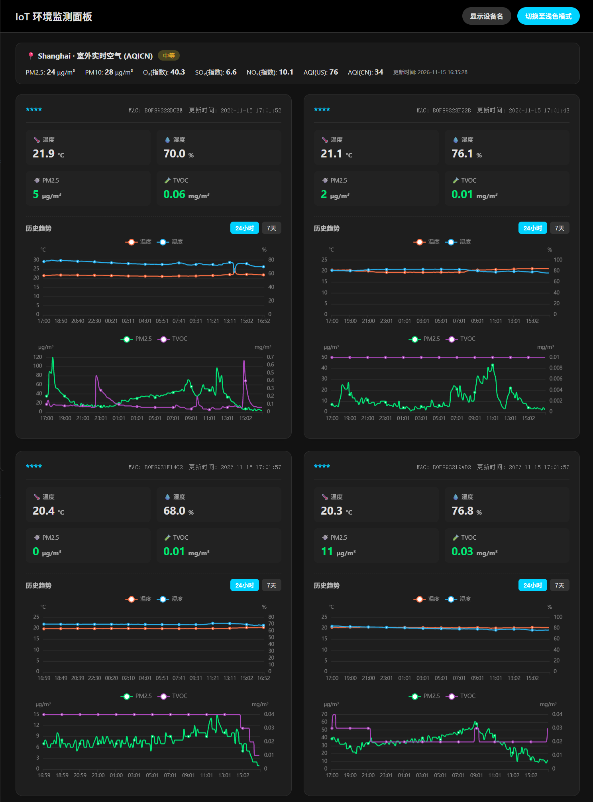

# ZM1 环境监测终端 (zm1_monitor)

`zm1_monitor` 是一个轻量级、响应式的 IoT 室内外环境监测面板系统。专为接入基于 MQTT 协议的智能空气检测设备（如斐讯 ZM1 等）设计，支持多设备管理、历史数据图表绘制、卡片拖拽排序、隐私脱敏及室外实时空气质量（AQICN）联动比对。


---

## 🌟前端截图



---

## 🌟 核心特性

- **多设备 MQTT 自动接入**：自动订阅并解析设备状态与传感器数据（温度、湿度、PM2.5、TVOC/甲醛）。
- **室外空气数据联动**：整合 AQICN API 接口，实时获取室外 PM2.5、PM10、O₃、SO₂、NO₂ 浓度，并同步计算展示 **US AQI** 与 **CN AQI (HJ 633-2012 国标)**。
- **可视化历史趋势**：采用 Apache ECharts 绘制 24 小时 / 7 天的温度、湿度、PM2.5 及 TVOC 历史数据折线图。
- **个性化 UI 操作**：
  - 支持 **深色/浅色模式** 一键无缝切换。
  - 支持 **设备名称一键隐藏脱敏**。
  - 支持 **长按设备卡片自由拖拽排序**（自动持久化保存至浏览器本地）。
  - 针对移动端屏幕全面优化，防折断响应式设计。
- **轻量高效架构**：基于 Flask + Waitress + SQLite 架构，内存占用低，非常适合部署在树莓派、NAS 或 Linux 轻量服务器上。

---

## 🛠️ 目录结构

```text
zm1_monitor/
├── app.py              # Flask 后端服务、MQTT 监听与数据处理逻辑
├── config.conf         # 项目配置文件 (端口/MQTT/室外API等)
├── requirements.txt    # Python 依赖清单
├── sensor_history.db   # SQLite 数据库文件 (运行后自动创建)
└── templates/
    └── index.html      # 前端 Web 界面与渲染逻辑
```

---

## 🚀 快速开始

### 1. 克隆/下载项目与环境准备

确保已安装 Python 3.8+ 及 `pip`：

```bash
# 拷贝或解压项目文件至目标目录
cd zm1_monitor

# (可选) 创建并激活虚拟环境
python3 -m venv venv
source venv/bin/activate

# 安装依赖库
pip install -r requirements.txt
```

### 2. 修改配置文件 `config.conf`

根据实际部署环境修改 `config.conf`：

```ini
[web]
host = 0.0.0.0
port = 18080

[mqtt]
broker = 127.0.0.1
port = 1883
topic = device/zm1/#
user = 
password = 

[storage]
db_file = sensor_history.db
# 历史采样记录间隔 (秒)，600 = 10 分钟记录一次
interval_seconds = 600
# 历史数据保留天数
retention_days = 7

[outdoor]
enabled = true
# 填入你在 https://aqicn.org/data-platform/token/ 申请的 token
token = demo
city = shanghai
refresh_interval = 1800
```

### 3. 运行服务

**直接启动测试：**

```bash
python app.py
```

终端输出 `服务已启动: http://0.0.0.0:18080` 后，即可在浏览器中访问页面。

---

## ⚙️ 系统服务配置 (Systemd)

推荐将本项目配置为后台常驻的 Systemd 服务：

1. 创建服务配置文件：

```bash
sudo nano /etc/systemd/system/zm1-monitor.service
```

2. 写入以下内容（注意修改路径和运行用户）：

```ini
[Unit]
Description=ZM1 Environment Monitor Service
After=network.target mqtt.service

[Service]
Type=simple
User=root
WorkingDirectory=/path/to/zm1_monitor
ExecStart=/path/to/zm1_monitor/venv/bin/python app.py
Restart=always
RestartSec=5

[Install]
WantedBy=multi-user.target
```

3. 启动并设置开机自启：

```bash
sudo systemctl daemon-reload
sudo systemctl enable zm1-monitor
sudo systemctl start zm1-monitor
```

---

## 📄 开源协议

本项目采用 **[MIT License](LICENSE)** 授权。你可以自由地使用、修改、分发及商业化本项目代码。

---

## 🙏 致谢与依赖说明 (Acknowledgements)

本项目在开发过程中使用了以下优秀的开源项目与 API 服务：

- [Flask](https://flask.palletsprojects.com/) (BSD-3-Clause) - Web 框架
- [Paho-MQTT](https://eclipse.org/paho/) (EPL-2.0 / EDL-1.0) - MQTT 客户端库
- [Waitress](https://docs.pylonsproject.org/projects/waitress/) (ZPL-2.1) - 生产级 WSGI 服务器
- [pytz](https://pythonhosted.org/pytz/) (MIT) - 时区转换处理
- [Apache ECharts](https://echarts.apache.org/) (Apache License 2.0) - 交互式图表库
- [World Air Quality Index Project (AQICN)](https://aqicn.org/) - 室外空气质量数据接口
